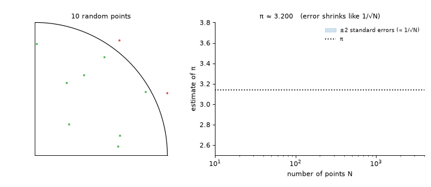
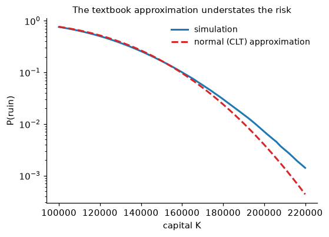
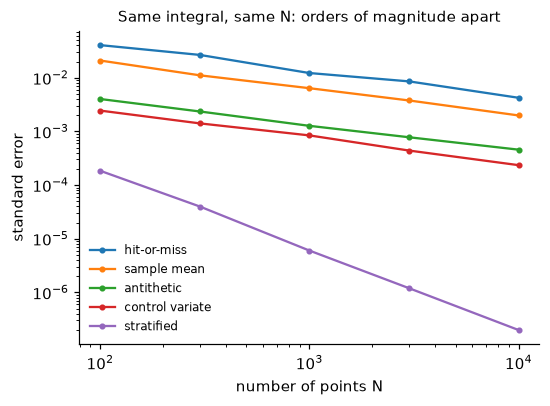
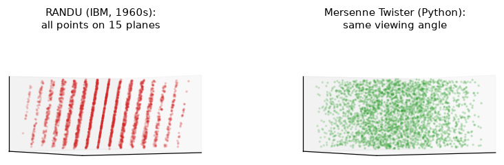
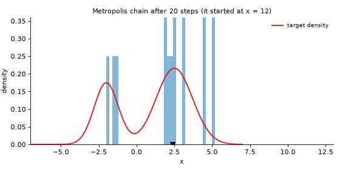
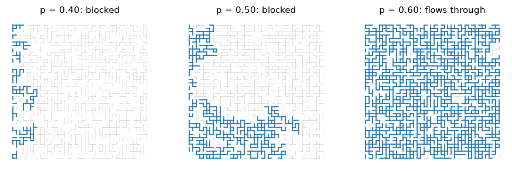
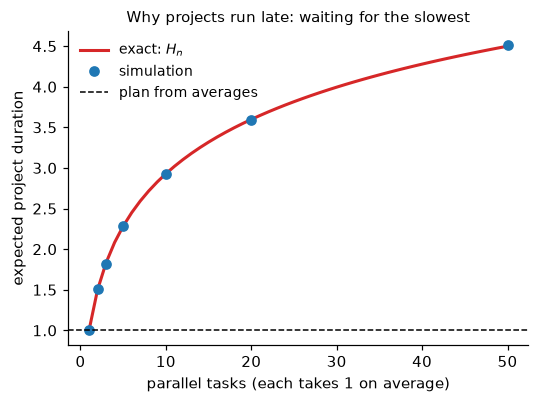

# Monte Carlo methods — worked notebooks



**28 executed Jupyter notebooks** on the Monte Carlo method, from first principles to real-world
problems — written for the Monte Carlo course at FJFI ČVUT (scriptum by M. Virius), and in **English
and Czech**. Every result is shown with its code, its plot, and a comparison against an **exact
answer** wherever one exists.

- **Open any notebook right here on GitHub** — outputs and figures are stored, nothing to install.
- **Standard library + matplotlib only.** Generators, tests and algorithms are written from scratch
  (`random`, `math`), then cross-checked against a NumPy version. No hidden machinery.
- **Verification first.** A simulation that "looks right" proves nothing, so each model is anchored
  to a formula or a limiting case (Black–Scholes, gambler's ruin, `E[max] = Hₙ`, Little's law …).
  Several mistakes were caught exactly this way — see [what the checks caught](#what-the-checks-caught).

## Highlights

<table>
<tr>
<td width="50%"></td>
<td width="50%"><b>Simulation vs. the textbook formula.</b> An insurance company's ruin probability: the
normal (CLT) approximation says 0.004, simulation says 0.007 — and unlike the formula, the simulation
comes with a measurable error. The gap widens in the tail, which is where the risk is.<br><br>
<a href="notebooks/en/02_insurance_company.ipynb">Notebook 2</a> ·
<a href="notebooks/en/09_insurance_company_complete.ipynb">Notebook 9</a> ·
<a href="notebooks/en/applications/insurance_realistic.ipynb">realistic model</a></td>
</tr>
<tr>
<td width="50%"><b>Variance reduction.</b> Five estimators of the same integral at the same cost.
Replacing hit-or-miss by the sample mean helps ~5×; a control variate ~60×; stratification changes the
<i>slope</i> of the error curve itself. For an Asian option, a control variate gives an <b>865×</b>
variance reduction.<br><br>
<a href="notebooks/en/07_variance_reduction.ipynb">Notebook 7</a> ·
<a href="notebooks/en/applications/option_pricing.ipynb">option pricing</a></td>
<td width="50%"></td>
</tr>
<tr>
<td width="50%"></td>
<td width="50%"><b>A famous generator that fails in 3D.</b> IBM's RANDU passes the frequency, poker, runs
and 2-D tests — and every consecutive triple lies on one of 15 planes. Only the 3-D serial test catches
it. Python's Mersenne Twister, viewed from the same angle, fills the cube.<br><br>
<a href="notebooks/en/extra/ch04_generators.ipynb">Generators</a> ·
<a href="notebooks/en/extra/ch04_tests_of_generators.ipynb">Testing generators</a></td>
</tr>
<tr>
<td width="50%"><b>Sampling where nothing else works.</b> The Metropolis algorithm builds the target
density from a random walk (animation: a chain started far from the target finds both peaks). The step
size matters enormously — a ~90× spread in effective samples — and the naive error bar understates the
truth.<br><br>
<a href="notebooks/en/applications/mcmc_metropolis.ipynb">Notebook</a></td>
<td width="50%"></td>
</tr>
<tr>
<td width="50%"></td>
<td width="50%"><b>A phase transition you can see.</b> Percolation on a lattice: below p = ½ the water
is stuck in islands, above it one giant cluster crosses. The exact value p<sub>c</sub> = ½ holds
<i>exactly</i> only on an L×(L+1) rectangle — on a square the data drift, and would have suggested the
wrong constant.<br><br>
<a href="notebooks/en/applications/percolation.ipynb">Percolation</a> ·
<a href="notebooks/en/applications/branching_process.ipynb">branching process</a> ·
<a href="notebooks/en/applications/bank_run.ipynb">bank run</a></td>
</tr>
<tr>
<td width="50%"><b>Why projects run late.</b> A plan built from averages is met in only ~38 % of runs.
For n parallel tasks the expected finish is exactly the harmonic number Hₙ, not the average: twenty
one-day tasks in parallel take 3.6 days. The critical path also moves from run to run.<br><br>
<a href="notebooks/en/applications/project_planning.ipynb">Notebook</a> ·
<a href="notebooks/en/applications/personal_budget.ipynb">personal budget</a> ·
<a href="notebooks/en/applications/system_reliability.ipynb">system reliability</a></td>
<td width="50%"></td>
</tr>
</table>

## What the checks caught

Writing simulations that agree with an exact answer is the point, and a few times the answer
disagreed — in the code, and once in the author's own claims. Examples (all fixed in the notebooks):

- A **geometric Asian option** formula was wrong twice before it was derived properly; found because
  two estimates of the same price disagreed by 5.7σ.
- **Percolation p<sub>c</sub> = ½** is not "exact for every L" on a square lattice — the data drifted
  from 0.567 to 0.513. The exact statement needs the L×(L+1) rectangle.
- A "which task finishes last" statistic in the project plan was **trivially 100 %** (it is the terminal
  task); replaced by a proper critical-path backtrack.
- Simulated annealing first came out *worse* than hill climbing: too hot a start and an unfair
  comparison. Fixed with a principled temperature and equal budgets.

## Notebooks

Each notebook has an English version (`notebooks/en/`) and a Czech twin (`notebooks/cs/`) that mirror
each other cell for cell.

### Lessons — the practical classes

| # | English | Czech | Topic |
|---|---------|-------|-------|
| 0 | [refresher](notebooks/en/00_refresher.ipynb) | [00_opakovani](notebooks/cs/00_opakovani.ipynb) | Expectation, variance, LLN, Chebyshev, CLT, confidence intervals |
| 1 | [intro to Monte Carlo](notebooks/en/01_intro_to_monte_carlo.ipynb) | [01_uvod_do_monte_carla](notebooks/cs/01_uvod_do_monte_carla.ipynb) | π by hit-or-miss and Buffon, integrals, error ∝ 1/√N, ball volume |
| 2 | [insurance company](notebooks/en/02_insurance_company.ipynb) | [02_pojistovna](notebooks/cs/02_pojistovna.ipynb) | Model, CLT vs simulation, ruin probability |
| 3 | [discrete distributions](notebooks/en/03_discrete_distributions.ipynb) | [03_diskretni_rozdeleni](notebooks/cs/03_diskretni_rozdeleni.ipynb) | Linear / reordered / bisection sampling, Poisson, geometric |
| 4 | [continuous distributions](notebooks/en/04_continuous_distributions.ipynb) | [04_spojita_rozdeleni](notebooks/cs/04_spojita_rozdeleni.ipynb) | Inverse transform, Cauchy (why the LLN fails), numerical inversion |
| 5 | [mixtures & ordered samples](notebooks/en/05_mixtures_and_ordered_samples.ipynb) | [05_superpozice_a_usporadane_vybery](notebooks/cs/05_superpozice_a_usporadane_vybery.ipynb) | Superposition, sorted samples in O(n), top-k of a huge sample |
| 6 | [rejection method](notebooks/en/06_rejection_method.ipynb) | [06_zamitaci_metoda](notebooks/cs/06_zamitaci_metoda.ipynb) | Box and envelope versions, normal from a Cauchy envelope, a wrong M |
| 7 | [variance reduction](notebooks/en/07_variance_reduction.ipynb) | [07_snizovani_rozptylu](notebooks/cs/07_snizovani_rozptylu.ipynb) | Antithetic, control variate, stratification, importance sampling |
| 8 | [distance in a ball](notebooks/en/08_distance_in_a_ball.ipynb) | [08_vzdalenost_v_kouli](notebooks/cs/08_vzdalenost_v_kouli.ipynb) | Uniform points in a ball, polar coordinates, symmetry, high dimensions |
| 9 | [insurance, complete](notebooks/en/09_insurance_company_complete.ipynb) | [09_pojistovna_kompletne](notebooks/cs/09_pojistovna_kompletne.ipynb) | Confidence intervals and coverage, rare ruin by importance sampling, required capital |

Notebook 2 builds the insurance model and stops where simulation beats the CLT estimate; notebook 9 is
the capstone that finishes it with the tools from 3–7.

### Extra — scriptum chapters the classes did not cover

Not numbered as lessons; the prefix is the *book chapter*.

| English | Czech | Topic |
|---------|-------|-------|
| [when MC pays off](notebooks/en/extra/ch01_05_when_mc_pays_off.ipynb) | [ch01_05_kdy_se_mc_vyplati](notebooks/cs/extra/ch01_05_kdy_se_mc_vyplati.ipynb) | Series sums, MC vs quadrature (crossover at d = 4), dependent samples |
| [Γ and B](notebooks/en/extra/ch03_gamma_beta.ipynb) | [ch03_gamma_beta](notebooks/cs/extra/ch03_gamma_beta.ipynb) | Summed exponentials, Marsaglia–Tsang, order statistics, χ² = Γ(k/2, ½) |
| [generators](notebooks/en/extra/ch04_generators.ipynb) | [ch04_generatory](notebooks/cs/extra/ch04_generatory.ipynb) | LCG, the RANDU planes, Mersenne Twister |
| [testing generators](notebooks/en/extra/ch04_tests_of_generators.ipynb) | [ch04_testy_generatoru](notebooks/cs/extra/ch04_testy_generatoru.ipynb) | χ², frequency, serial, poker, runs, autocorrelation |
| [Markov chains & linear equations](notebooks/en/extra/ch06_markov_linear_equations.ipynb) | [ch06_markov_linearni_rovnice](notebooks/cs/extra/ch06_markov_linearni_rovnice.ipynb) | Solving Ax = b by random walks (von Neumann–Ulam) |
| [walk & PDEs](notebooks/en/extra/ch06_walk_and_pde.ipynb) | [ch06_prochazka_a_pde](notebooks/cs/extra/ch06_prochazka_a_pde.ipynb) | Dirichlet and Poisson problems, walk on spheres |
| [queueing](notebooks/en/extra/ch07_queueing.ipynb) | [ch07_hromadna_obsluha](notebooks/cs/extra/ch07_hromadna_obsluha.ipynb) | M/M/1, Δt model vs discrete-event model, warm-up |
| [stochastic algorithms](notebooks/en/extra/ch09_stochastic_algorithms.ipynb) | [ch09_stochasticke_algoritmy](notebooks/cs/extra/ch09_stochasticke_algoritmy.ipynb) | Miller–Rabin primality, simulated annealing |

### Applications — beyond the scriptum

| English | Czech | Topic |
|---------|-------|-------|
| [insurance, realistic](notebooks/en/applications/insurance_realistic.ipynb) | [pojistovna_realisticky](notebooks/cs/aplikace/pojistovna_realisticky.ipynb) | Gradual premiums, clustered claims, generalised Lundberg bound, payout delays, a handling queue |
| [MCMC / Metropolis](notebooks/en/applications/mcmc_metropolis.ipynb) | [mcmc_metropolis](notebooks/cs/aplikace/mcmc_metropolis.ipynb) | Step size, autocorrelation time, burn-in, batch-means errors, a 20-D ball |
| [personal budget](notebooks/en/applications/personal_budget.ipynb) | [osobni_rozpocet](notebooks/cs/aplikace/osobni_rozpocet.ipynb) | Emergency fund, saving goal as gambler's ruin, which uncertainty drives the risk |
| [option pricing](notebooks/en/applications/option_pricing.ipynb) | [oceneni_opci](notebooks/cs/aplikace/oceneni_opci.ipynb) | Black–Scholes check, antithetic, Asian option (865× control variate), barrier option |
| [branching process](notebooks/en/applications/branching_process.ipynb) | [vetvici_proces](notebooks/cs/aplikace/vetvici_proces.ipynb) | Extinction as a root of s = G(s), the phase transition at R₀ = 1 |
| [percolation](notebooks/en/applications/percolation.ipynb) | [perkolace](notebooks/cs/aplikace/perkolace.ipynb) | p<sub>c</sub> = ½ by self-duality, the giant cluster |
| [project planning](notebooks/en/applications/project_planning.ipynb) | [planovani_projektu](notebooks/cs/aplikace/planovani_projektu.ipynb) | E[max] = Hₙ, the moving critical path, where extra effort pays |
| [system reliability](notebooks/en/applications/system_reliability.ipynb) | [spolehlivost_systemu](notebooks/cs/aplikace/spolehlivost_systemu.ipynb) | Series/parallel formulas, diminishing returns, rare failures |
| [bootstrap](notebooks/en/applications/bootstrap.ipynb) | [bootstrap](notebooks/cs/aplikace/bootstrap.ipynb) | Intervals for any statistic, a coverage experiment, where it fails |
| [bank run](notebooks/en/applications/bank_run.ipynb) | [run_na_banku](notebooks/cs/aplikace/run_na_banku.ipynb) | Self-exciting process, avalanche size 1/(1−n), where to intervene |

### Reference

- [`notation.md`](notation.md) — symbols used, matched to the scriptum (bilingual).
- [`toc_book.md`](toc_book.md) — contents of the scriptum.
- [`plan.md`](plan.md) — what is still open.
- [`docs/make_figures.py`](docs/make_figures.py) — regenerates the images above.

## Setup with uv

1. Install [uv](https://docs.astral.sh/uv/) (once):

   ```bash
   # macOS
   brew install uv
   # or, any Unix
   curl -LsSf https://astral.sh/uv/install.sh | sh
   ```

2. From this folder, create the environment and start JupyterLab:

   ```bash
   cd MEMC
   uv sync              # creates .venv with matplotlib + jupyterlab
   uv run jupyter lab   # opens JupyterLab in your browser
   ```

   Then open `notebooks/en/00_refresher.ipynb`. The kernel *Python 3 (ipykernel)* is the project's `.venv`, so no extra kernel setup is needed.

3. Optional SciPy alternatives (NumPy is already installed together with matplotlib):

   ```bash
   uv sync --extra alt
   ```

   Without this, the SciPy cells in later notebooks print a hint and the rest still runs.

### One-off run without syncing

```bash
uv run --with jupyterlab --with matplotlib jupyter lab
```

### Check that a notebook runs from top to bottom

```bash
uv run jupyter nbconvert --to notebook --execute --ExecutePreprocessor.timeout=600 notebooks/en/00_refresher.ipynb --output-dir /tmp
```

### VS Code instead of JupyterLab

Open the folder, run `uv sync`, open a notebook and pick the interpreter `.venv/bin/python` as its kernel.

## Notes

- Notebooks seed the random generator, so results are reproducible; change the seed to see the variation.
- Everything uses Python 3.10 or newer.

### Regenerate the README figures

```bash
uv run python docs/make_figures.py   # writes docs/img/ (needs Pillow, which ships with matplotlib)
```
